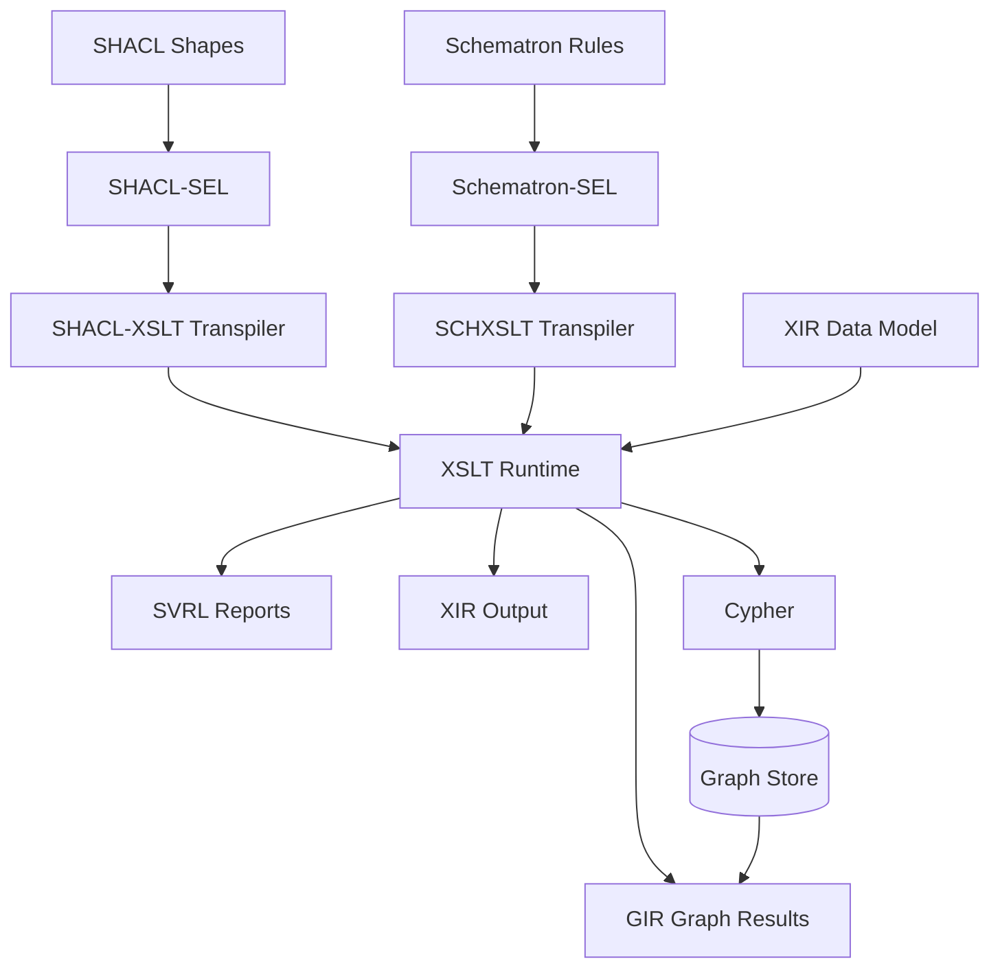
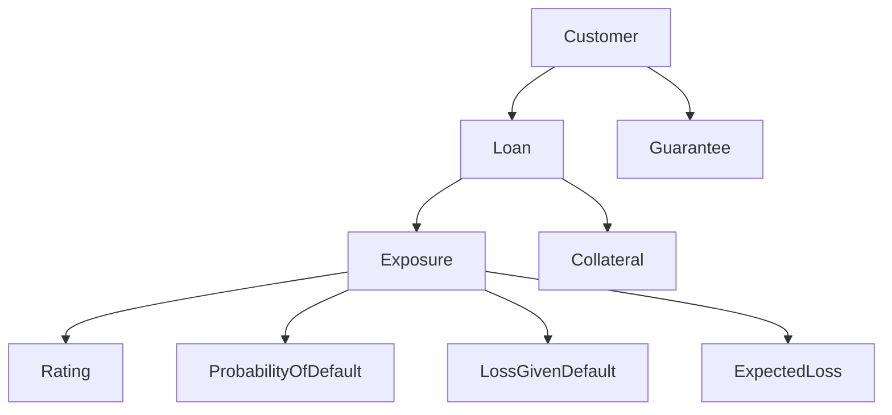
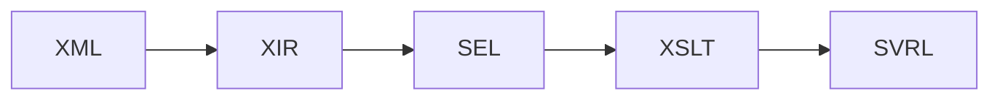
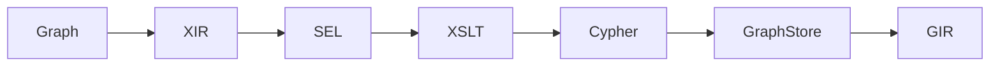
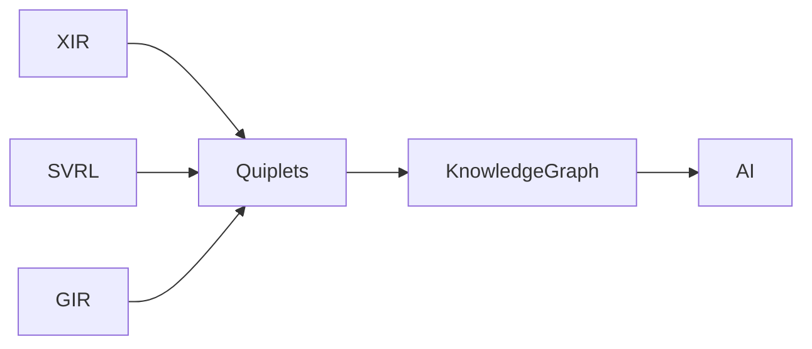

# Credit Risk Architecture: SEL, XSLT, XIR

## Vision

- SEL = declarative rule language
- XSLT = universal execution runtime
- XIR = common interchange model
- SVRL = tree-oriented result vocabulary
- GIR = graph-oriented result vocabulary
- Quiplets = AI-oriented semantic representation

## Architecture



## Credit Risk Domain



## SEL Example

```sel
for Exposure
assert ProbabilityOfDefault <= 1
assert LossGivenDefault <= 1
assert ExpectedLoss =
       ExposureAmount *
       ProbabilityOfDefault *
       LossGivenDefault
```

## Schematron Path



Example result:

```text
SVRL
 ├─ failed-assert
 ├─ successful-report
 └─ diagnostics
```

## SHACL Path



## Credit Concentration Rule

```sel
for Customer
report
sum(ExposureAmount)
group by Sector
where
sum(ExposureAmount) >
0.25 * TotalPortfolio
```

Generated Cypher:

```cypher
MATCH
 (c:Customer)-[:OWNS]->(e:Exposure)
RETURN
 c.sector,
 sum(e.amount)
```

## GIR Example

```text
GIR
 └─ Result
     ├─ Sector = RealEstate
     ├─ Exposure = 470M
     ├─ PortfolioShare = 31%
     └─ Status = HighConcentration
```

## AI Semantic Extraction

```text
(Customer, owns, Exposure)
(Exposure, hasPD, 0.03)
(Exposure, hasLGD, 0.42)
(ExpectedLoss, derivedFrom, ExposureAmount)
(RealEstate, exceedsConcentrationLimit, true)
```

## AI Pipeline



## Summary

```text
SEL       = one rule language
XSLT      = one execution runtime
XIR       = one interchange model
SVRL      = tree result vocabulary
GIR       = graph result vocabulary
Quiplets  = AI reasoning substrate
```
