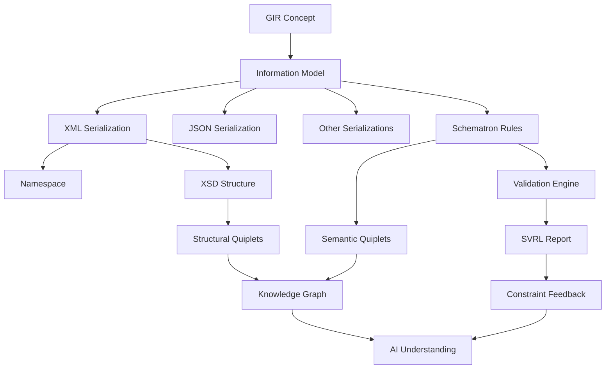
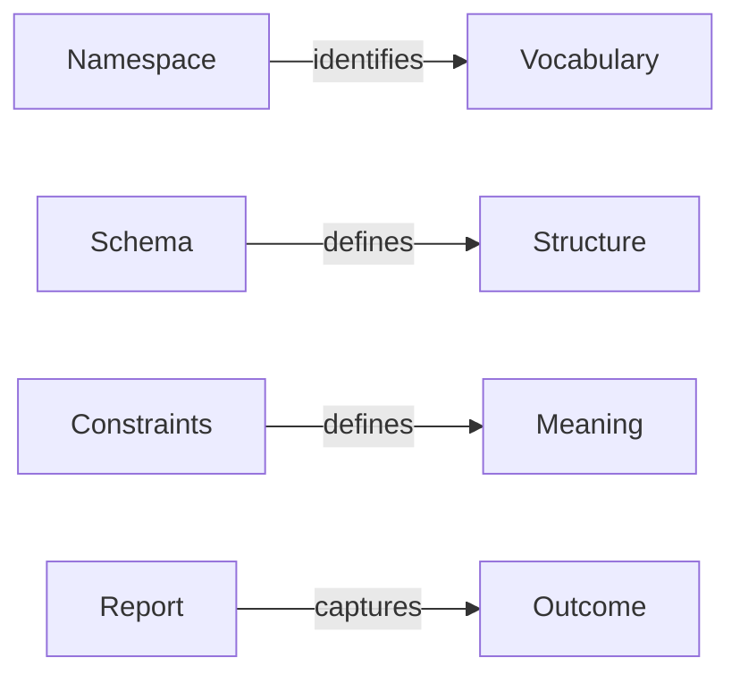
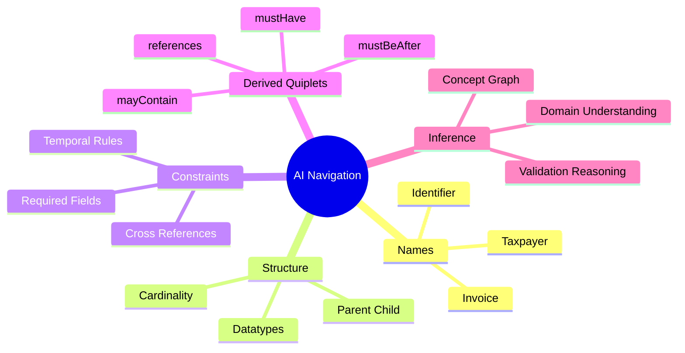
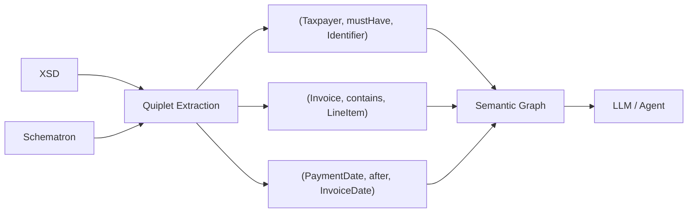

# GIR / Schematron / AI Semantics Draft

## Core Concepts

```text
GIR = concept
Namespace = identity
XSD = structure
Schematron = intent
SVRL = outcome
Quiplets = AI-optimized representation
Knowledge graph = inferred model
```

## Architectural Overview



## Separation of Concerns



## AI Navigation Model



## Quiplet Extraction Pipeline



## Design Principle

Schemas tell AI what exists.

Constraints tell AI what matters.

Quiplets tell AI what it can infer.

The most valuable AI-facing layer is likely the automatically generated semantic layer derived from schemas and constraints rather than additional meta-modeling.
